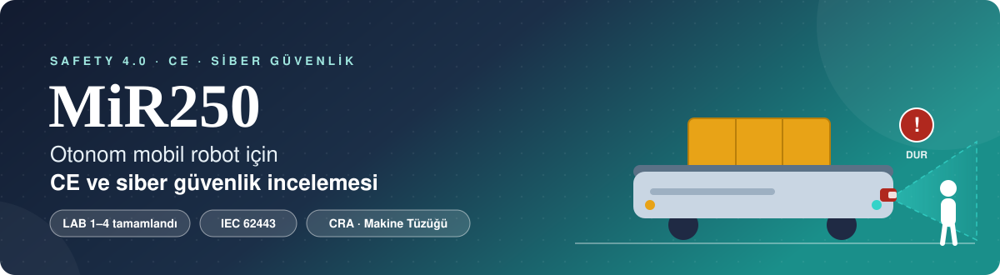
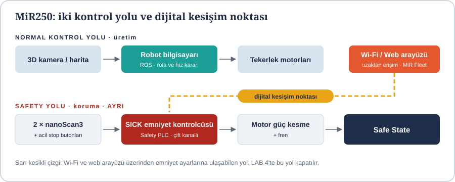
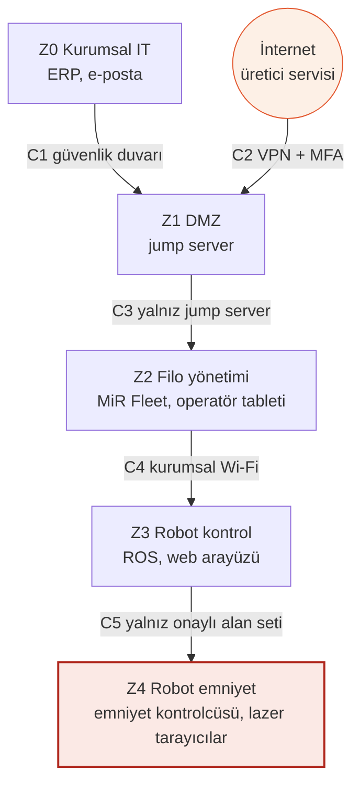

<div align="center">



<br>


**[📌 Amaç](#-projenin-amacı) · [📂 İçerik](#-depo-içeriği) · [🤖 Makine](#-seçilen-makine) · [🧪 Laboratuvarlar](#-laboratuvar-özeti) · [🧭 SWOT](#-swot-özeti) · [📈 Durum](#-durum)**

</div>

<br>

| Ders | Hazırlayan | Grup | Güncelleme |
| :-: | :-: | :-: | :-: |
| Yazılım Mühendisliği Güncel Konular | **Betül Altunyuva** | Gece-B | 23.10.2026 |

---

## 📌 Projenin amacı

Bu çalışma, **Mobile Industrial Robots (MiR) / MiR250 Otonom Mobil Robot (AMR – Fabrika İçi Malzeme Taşıma)** için bir CE teknik dosyasının siber güvenlik bölümünü eğitim amaçlı hazırlar. Şu soruların cevabını arar:

- 🛡️ Hangi **emniyet fonksiyonu** insanı koruyor?
- 🚪 Hangi **kapılardan** (Wi-Fi, web arayüzü, uzak erişim) içeri girilebilir?
- ⚖️ Hangi **risk** önce ele alınmalı?
- 🔒 Nasıl **korunulur**?

> ⚠️ Bu depo **gerçek bir CE belgesi, belgelendirme veya emniyet garantisi değildir.** Kamuya açık dokümanlara dayanan bir eğitim çıktısıdır. Ayrıntı: [PROJE_KAPSAMI.md](PROJE_KAPSAMI.md)

---

## 📂 Depo içeriği

```
├── docs/
│   ├── sisleme/      Lab1 · Lab2 · Lab3 · Lab4
│   ├── paketleme/    Lab1 · Lab2 · Lab3 · Lab4
│   └── rapor/        ayrıntılı rapor
├── analizler/        SWOT ve SMART analizleri
├── kaynaklar/        kaynak listesi ve CVE kaydı
├── assets/           README görselleri
├── PROJE_KAPSAMI.md
└── HAFTALIK_ILERLEME.md
```

| | Dosya | Açıklama |
| :-: | --- | --- |
| 📄 | [docs/sisleme/](docs/sisleme) | Şişeleme föyü: LAB 1–4, MiR250'ye göre doldurulmuş, her lab ayrı PDF |
| 📄 | [docs/paketleme/](docs/paketleme) | Paketleme (PaketPro 3000) föyü: LAB 1–4, MiR250'ye göre doldurulmuş, her lab ayrı PDF |
| 📘 | [Ayrıntılı rapor](docs/rapor/MiR250_Safety40_Lab_Raporu_LAB1-4.pdf) | Makine tanımı, bileşen listesi ve LAB 1–4 |
| 🧭 | [SWOT analizi](analizler/SWOT_Analizi.md) | [PDF sürümü](analizler/SWOT_Analizi_MiR250_BetulAltunyuva.pdf) de var |
| 🎯 | [SMART analizi](analizler/SMART_Analizi.md) | Hedef, iş paketleri, izleme göstergeleri |
| 📚 | [Kaynaklar](kaynaklar/Kaynaklar.md) | Kaynaklar, doğrulama durumları, CVE değerlendirme kaydı |
| 🗺️ | [PROJE_KAPSAMI.md](PROJE_KAPSAMI.md) | Kapsam, veri sınıflandırması, teknik dosya taslağı bölümleri |
| 📈 | [HAFTALIK_ILERLEME.md](HAFTALIK_ILERLEME.md) | Haftalık ilerleme ve güncelleme kuralı |

---

## 🤖 Seçilen makine

|  🏋️ **250 kg**  |  ⚡ **2,0 m/s**  |  🛰️ **2 × nanoScan3**  |  📶 **Wi-Fi + Ethernet**  |
| :-: | :-: | :-: | :-: |
| azami yük | azami hız (7,2 km/h) | 360° lazer tarayıcı | web arayüzü ve MiR Fleet |

| | |
| --- | --- |
| **Üretici / model** | Mobile Industrial Robots A/S · MiR250 |
| **Makine türü** | Otonom mobil robot (AMR), fabrika içi malzeme taşıma |
| **Ağırlık** | 97 kg |
| **Emniyet donanımı** | 2 × SICK nanoScan3 lazer tarayıcı + SICK emniyet kontrolcüsü |
| **Ortam** | Yalnızca kapalı alan, IP21 |
| **Bilinmeyenler** | Robotun gerçek yazılım sürümü ve parola durumu; emniyet fonksiyonlarının üretici PL beyanı |

### Emniyet mimarisi

<div align="center">

</div>

---

## 🔎 Güvenlik açığı incelemesi

CISA ICSA-21-280-02, MiR250'yi de kapsayan bir dizi açık listeler (yazılım 2.10.2.1 öncesi). Bu çalışmada özellikle şunlar kullanıldı:

| CVE | Konu | Kaynak |
| --- | --- | --- |
| CVE-2020-10276 | Emniyet kontrolcüsünde varsayılan parola (Haziran 2020 öncesi robotlar) | CISA · CVSS 8,8 |
| CVE-2020-10271 / 10272 | ROS arayüzü kimlik doğrulamasız | CISA · CVSS 9,8 / 8,8 |
| CVE-2020-10277 / 10278 | USB'den açılış açık, BIOS parolası yok | CISA · CVSS 6,4 / 4,6 |
| CVE-2020-10269 / 10270 | Varsayılan Wi-Fi ve panel parolaları | Araştırmacı bildirimi · **MiR250 için etki doğrulanmadı** |

> ℹ️ Bu tablo, incelenen robotun savunmasız olduğunu **kanıtlamaz**. Uygulanabilirlik için robotun sürümü, sevk tarihi ve parola durumu gerekir. Kayıt: [kaynaklar/Kaynaklar.md](kaynaklar/Kaynaklar.md)

---

## 🧪 Laboratuvar özeti

| Lab | Konu | Çıktı | Evidence Pack |
| --- | --- | --- | :-: |
| **LAB 1** | Safety Architecture | Safety Function Map | EP 03 |
| **LAB 2** | IEC 62443 Mini Workshop | Zone / Conduit Diagram | EP 05 |
| **LAB 3** | Threat & Risk + Risk Matrix | Risk Register | EP 04 |
| **LAB 4** | Secure Remote Access | Secure Architecture | EP 02 · EP 06 |

### 🗺️ Zone / Conduit



Emniyet kontrolcüsü ayrı ve en kritik bölgeye (**Z4**) konur; robot bilgisayarı ele geçirilse bile emniyet ayarlarına ağ üzerinden ulaşılamamalıdır.

### ⚖️ Risk Register (LAB 3)

| # | Senaryo | L | S | E | Skor | Bant |
| --- | --- | :-: | :-: | :-: | :-: | --- |
| **R-01** | Fırsatçı dış saldırgan → varsayılan parolalı robot Wi-Fi'ı → koruma alanı küçülür / hız artar → çalışana çarpma | 3 | 3 | 3 | **27** | 🔴 Kritik · S3 |
| **R-02** | Meraklı içeriden → paylaşılan web hesabı → gereksiz susturma bölgesi → raf ile robot arasında ezilme | 2 | 3 | 2 | **12** | 🟠 Yüksek · S3 |
| **R-03** | Tedarik zinciri → servis erişimi → hatalı harita dosyası → yasak bölge kalkar, çarpma | 2 | 3 | 1 | **6** | 🟡 Orta · S3 |

> 🚩 **S3 kuralı:** Şiddeti 3 olan senaryo, skoru düşük olsa bile ayrı bayrak alır ve en az bir önlem ya da yazılı kabul kararı olmadan kapatılmaz.

### 🔒 R-01 riskinin LAB 4 sonrası değişimi

| Durum | L · S · E | Skor | Bant |
| --- | :-: | :-: | --- |
| Bugün | 3 · 3 · 3 | 27 | 🔴 Kritik |
| + Erişim önlemleri (jump server, VPN, MFA, kişisel hesap) | 1 · 3 · 2 | 6 | 🟡 Orta (S3 sürer) |
| + Emniyet bağımsızlığı (ayarlar ağdan ayrı) | 1 · 1 · 2 | 2 | ⚪ Düşük |

> Erişim önlemleri **L ve E**'yi düşürür; **S**'yi yalnızca emniyet tasarımı düşürür.

---

## 🧭 SWOT özeti

| 💪 **Güçlü yönler** | ⚠️ **Zayıf yönler** |
| --- | --- |
| • Ayrı emniyet zinciri (lazer tarayıcı + emniyet kontrolcüsü)<br>• Hazır emniyet fonksiyonları<br>• Açık dokümantasyon<br>• Yama sürümü belli (2.10.2.1) | • Varsayılan parola açıkları<br>• Kimlik doğrulamasız ROS arayüzü<br>• USB boot açık, BIOS parolası yok<br>• Emniyet ayarlarına ağdan ulaşılabilmesi |
| 🚀 **Fırsatlar** | 🛑 **Tehditler** |
| • Yazılım güncellemesi<br>• Jump server + VPN + MFA<br>• Emniyet ayarlarını ağdan ayırmak<br>• CRA ve Makine Tüzüğü takvimi | • Fırsatçı dış saldırgan<br>• Meraklı içeriden<br>• Tedarik zinciri<br>• Hukuki ve fiziksel sonuç (S3) |

📎 Ayrıntı: [analizler/SWOT_Analizi.md](analizler/SWOT_Analizi.md) · [SMART analizi](analizler/SMART_Analizi.md)

---

## 📏 Çalışma ilkeleri

1. Doğrulanmış bilgi, bilinmeyenler ve akademik öneriler birbirinden ayrı tutulur.
2. Her kaynağın doğrulama durumu yazılır; okunmayan kaynak okunmuş gibi sunulmaz.
3. Senaryolar fiziksel sonuçla biter; "veri çalındı" ile biten kayıt emniyet bulgusu sayılmaz.
4. Fiziksel sistemlerde yetkisiz tarama, erişim veya yapılandırma değişikliği yapılmaz.
5. Bu depo resmî uygunluk belgesinin yerine geçmez.

## 🔄 Haftalık güncelleme yöntemi

- Yeni laboratuvar, `docs/sisleme/` ve `docs/paketleme/` klasörlerine sıradaki numarayla ayrı PDF olarak eklenir.
- Önceki teslimlerin içeriği değiştirilmez; düzeltmeler yeni commit'te nedeniyle yazılır.
- Commit mesajı biçimi: `docs: LAB 5 föyü eklendi (gg.aa.yyyy)`.

---

## 📈 Durum

✅ LAB 1 &nbsp;→&nbsp; ✅ LAB 2 &nbsp;→&nbsp; ✅ LAB 3 &nbsp;→&nbsp; ✅ LAB 4 &nbsp;→&nbsp; ⬜ LAB 5 &nbsp;→&nbsp; ⬜ LAB 6 &nbsp;→&nbsp; ⬜ LAB 7

| Bölüm | Depo durumu |
| --- | :-: |
| LAB 1 · Safety Architecture | ✅ Tamamlandı |
| LAB 2 · IEC 62443 Mini Workshop | ✅ Tamamlandı |
| LAB 3 · Threat & Risk | ✅ Tamamlandı |
| LAB 4 · Secure Remote Access | ✅ Tamamlandı |
| LAB 5 · SBOM / CVE / Patch | ⬜ Henüz eklenmedi |
| LAB 6 · CRA Incident Simulation | ⬜ Henüz eklenmedi |
| LAB 7 · AI Safety Challenge | ⬜ Henüz eklenmedi |

**Planlanan devam:** kaynak envanteri → SBOM ve CVE kararları (LAB 5) → olay müdahale akışı (LAB 6) → yapay zekâ başarısızlık kararı (LAB 7) → akademik CE teknik dosya taslağı.

---

<div align="center">

<sub>Bu depo bir eğitim çıktısıdır; resmî denetim, uygunluk değerlendirmesi veya belgelendirme değildir ve CE/mevzuat uygunluğu garantisi vermez.</sub>

</div>
