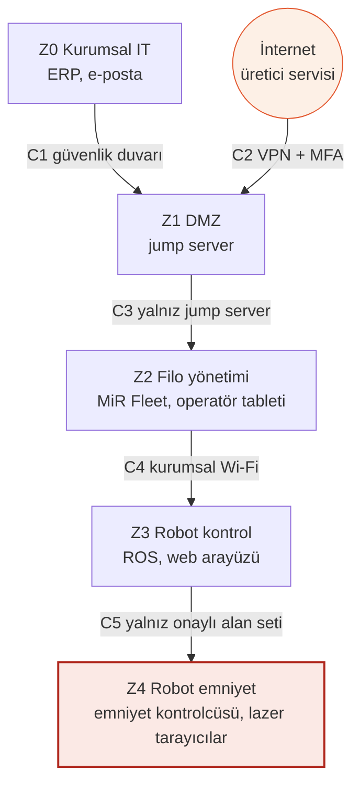

# 🤖 MiR250 · Safety 4.0 Lab Çalışmaları

**Otonom mobil robotun (AMR) siber güvenlik ve emniyet analizi**

Yazılım Mühendisliği Güncel Konular dersi · **Betül Altunyuva** · Gece-B

---

## 📌 Proje özeti

Bu çalışmada **Mobile Industrial Robots (MiR) / MiR250 Otonom Mobil Robot (AMR – Fabrika İçi Malzeme Taşıma)** için Safety 4.0 laboratuvarlarının ilk dört haftası uygulandı. Amaç, makinenin bir CE dosyasına girecek siber güvenlik bölümünü kendi çapımızda hazırlamak: hangi emniyet fonksiyonu korunuyor, hangi kapılardan girilebilir, hangi risk önce ele alınmalı ve nasıl korunulur.

MiR250 seçildi çünkü **teknik dokümanı herkese açık** ve **bilinen açıkları yayımlanmış** (CISA ICSA-21-280-02). Bu sayede LAB'lardaki senaryolar gerçek CVE'lere dayanıyor.

| | |
| --- | --- |
| **Ağırlık / Yük** | 97 kg / en fazla 250 kg |
| **Azami hız** | 2,0 m/s (7,2 km/h) |
| **Emniyet donanımı** | 2 × SICK nanoScan3 lazer tarayıcı (360°) + SICK emniyet kontrolcüsü |
| **Ağ** | Wi-Fi (2,4 / 5 GHz), Ethernet, web arayüzü (port 80), MiR Fleet |
| **Kullanım ortamı** | Yalnızca kapalı alan, IP21 |

---

## 📂 Depo içeriği

| Klasör | Dosya | Açıklama |
| --- | --- | --- |
| [`foyler/`](foyler) | [Şişeleme föyü (PDF)](foyler/Lab1-4_Sisleme_MiR250_BetulAltunyuva.pdf) | LAB 1–4, MiR250'ye göre doldurulmuş |
| [`foyler/`](foyler) | [Paketleme föyü (PDF)](foyler/Lab1-4_Paketleme_MiR250_BetulAltunyuva.pdf) | PaketPro 3000 föyü, LAB 1–4, MiR250'ye göre doldurulmuş |
| [`rapor/`](rapor) | [Ayrıntılı rapor (PDF)](rapor/MiR250_Safety40_Lab_Raporu_LAB1-4.pdf) | Makine tanımı, bileşen listesi ve LAB 1–4 |
| [`swot/`](swot) | [SWOT analizi (PDF)](swot/SWOT_Analizi_MiR250_BetulAltunyuva.pdf) | Aşağıda özeti de var |

---

## 🧪 Laboratuvarlar

| Lab | Konu | Çıktı | Evidence Pack |
| --- | --- | --- | --- |
| **LAB 1** | Safety Architecture | Safety Function Map | EP 03 |
| **LAB 2** | IEC 62443 Mini Workshop | Zone / Conduit Diagram | EP 05 |
| **LAB 3** | Threat & Risk + Risk Matrix | Risk Register | EP 04 |
| **LAB 4** | Secure Remote Access | Secure Architecture | EP 02, EP 06 |

### LAB 1 · Emniyet fonksiyonları

| Kod | Emniyet fonksiyonu | Ne yapar |
| --- | --- | --- |
| SF-1 | İnsan algılama | Koruma alanında biri görülürse robot durur |
| SF-2 | Acil durdurma | Butona basılınca robot durur |
| SF-3 | Aşırı hız önleme | Robot emniyet hız sınırını aşamaz |
| SF-4 | Hıza bağlı alan değişimi | Hız arttıkça koruma alanı büyür |

Güvenli durum: motor gücü kesilmiş, frenler devrede, robot durmuş. Hedeflenen güvenilirlik **PL d** (üretici beyanı kılavuzdan doğrulanmalıdır).

### LAB 2 · Zone / Conduit

Emniyet kontrolcüsü ayrı ve en kritik bölgeye (**Z4**) konur; robot bilgisayarı ele geçirilse bile emniyet ayarlarına ağ üzerinden ulaşılamamalıdır.

### LAB 3 · Risk Register

| # | Senaryo | L | S | E | Skor | Bant |
| --- | --- | :-: | :-: | :-: | :-: | --- |
| **R-01** | Fırsatçı dış saldırgan → varsayılan parolalı robot Wi-Fi'ı → koruma alanı küçülür / hız artar → çalışana çarpma | 3 | 3 | 3 | **27** | 🔴 Kritik · S3 |
| **R-02** | Meraklı içeriden → paylaşılan web hesabı → gereksiz susturma bölgesi → raf ile robot arasında ezilme | 2 | 3 | 2 | **12** | 🟠 Yüksek · S3 |
| **R-03** | Tedarik zinciri → servis erişimi → hatalı harita dosyası → yasak bölge kalkar, çarpma | 2 | 3 | 1 | **6** | 🟡 Orta · S3 |

> **S3 kuralı:** Şiddeti 3 olan senaryo, skoru düşük olsa bile ayrı bayrak alır ve en az bir önlem ya da yazılı kabul kararı olmadan kapatılmaz.

### LAB 4 · Güvenli uzak erişim

| Mevcut | Hedef |
| --- | --- |
| Robot ve Fleet'e doğrudan erişim | **Jump server** üzerinden erişim |
| Varsayılan, paylaşılan parolalar | **Kişisel hesap** |
| Tek faktör | **MFA** |
| Servis erişimi sürekli açık | **Varsayılan kapalı**, süreli açılır |
| Kim ne yaptı bilinmiyor | **Tam oturum kaydı** |

**R-01 riskinin değişimi:**

| Durum | L · S · E | Skor | Bant |
| --- | :-: | :-: | --- |
| Bugün | 3 · 3 · 3 | 27 | 🔴 Kritik |
| + Erişim önlemleri | 1 · 3 · 2 | 6 | 🟡 Orta (S3 sürer) |
| + Emniyet bağımsızlığı | 1 · 1 · 2 | 2 | ⚪ Düşük |

> Erişim önlemleri **L ve E**'yi düşürür; **S**'yi yalnızca emniyet tasarımı düşürür.

---

## 🧭 SWOT analizi

| 💪 **Güçlü yönler** (iç · olumlu) | ⚠️ **Zayıf yönler** (iç · olumsuz) |
| --- | --- |
| • **Ayrı emniyet zinciri:** 2 × SICK nanoScan3 (360°) ve emniyet kontrolcüsü robot bilgisayarından ayrı çalışır • **Hazır emniyet fonksiyonları:** insan algılama, acil durdurma, aşırı hız önleme • **Açık dokümantasyon:** teknik özellik sayfası, kılavuz ve CISA danışma notu herkese açık • **Uyumluluk beyanı:** CE, EN 1525, ANSI B56.5, ANSI R15.08 • **Yama mevcut:** yazılım 2.10.2.1 ve sonrası | • **Varsayılan parolalar** kılavuzda yazılı (CVE-2020-10269, CVE-2020-10270) • **Kimlik doğrulamasız ROS arayüzü** (CVE-2020-10271, CVE-2020-10272) • **Emniyet kontrolcüsü parolası** Haziran 2020 öncesi robotlarda varsayılan (CVE-2020-10276) • **Fiziksel erişim:** USB'den açılış açık, BIOS parolası yok (CVE-2020-10277, CVE-2020-10278) • **Web arayüzü** aşırı yükle yanıtsız kalabilir (CVE-2020-10280) • Bu çalışmanın analizine göre emniyet ayarlarına ağ üzerinden ulaşılabiliyor |
| 🚀 **Fırsatlar** (dış · olumlu) | 🛑 **Tehditler** (dış · olumsuz) |
| • **Güncelleme ve sertleştirme:** yazılımı en az 2.10.2.1'e yükseltmek, varsayılan parolaları değiştirmek • **Erişim güvenliği:** jump server, VPN, MFA, kişisel hesap, oturum kaydı (R-01: 27 → 6) • **Emniyet bağımsızlığı:** ayarları ağdan ayırmak R-01'i 6'dan 2'ye düşürür • **Mevzuat takvimi:** CRA bildirimi 11 Eylül 2026'dan beri, Makine Tüzüğü 20 Ocak 2027'de • **SBOM ve CVE takibi** ile yama kararlarını kayıt altına almak | • **Fırsatçı dış saldırgan:** parolalar kılavuzda, Wi-Fi sürekli yayında (R-01) • **Meraklı içeriden:** paylaşılan hesapla susturma bölgesi eklenebilir (R-02) • **Tedarik zinciri:** servis ya da güncelleme yoluyla hatalı harita/yazılım (R-03) • **Güncellenmemiş filo:** 2.10.2.1 öncesi robotlarda açıklar sürer • **Hukuki sonuç:** CRA cezası en fazla 15 M€ ya da cironun %2,5'i • **Fiziksel sonuç:** 350 kg'a kadar hareketli kütle, ağır yaralanma riski (S3) |

**Sonuç:** MiR250'nin emniyet donanımı güçlü; asıl risk **varsayılan parolalar ve ağ üzerinden değişebilen emniyet ayarlarıdır**. En hızlı kazanç yazılım güncellemesi ve parola değişikliği, kalıcı çözüm emniyet ayarlarını ağdan bağımsız tutmaktır.

---

## 📚 Kaynaklar

- [CISA ICSA-21-280-02: Mobile Industrial Robots Vehicles and MiR Fleet Software](https://www.cisa.gov/ics/advisories/icsa-21-280-02)
- [MiR250 Specifications (2023-06-28)](https://www.hartfiel.com/wp-content/uploads/2024/04/MiR250-Specs.pdf)
- [MiR250 ürün dokümanları](https://mobile-industrial-robots.com/product-documents/mir250-hw-20-sw-2-v1)
- [CVE-2020-10269](https://db.gcve.eu/vuln/CVE-2020-10269) · [CVE-2020-10270](https://vulnerability.circl.lu/vuln/CVE-2020-10270)
- INSPECCO × Kriptarium, Safety 4.0 Readiness Bootcamp föyleri ve sunumları

---

Bu depo bir eğitim çıktısıdır; resmî denetim, uygunluk değerlendirmesi veya belgelendirme değildir ve CE/mevzuat uygunluğu garantisi vermez.

